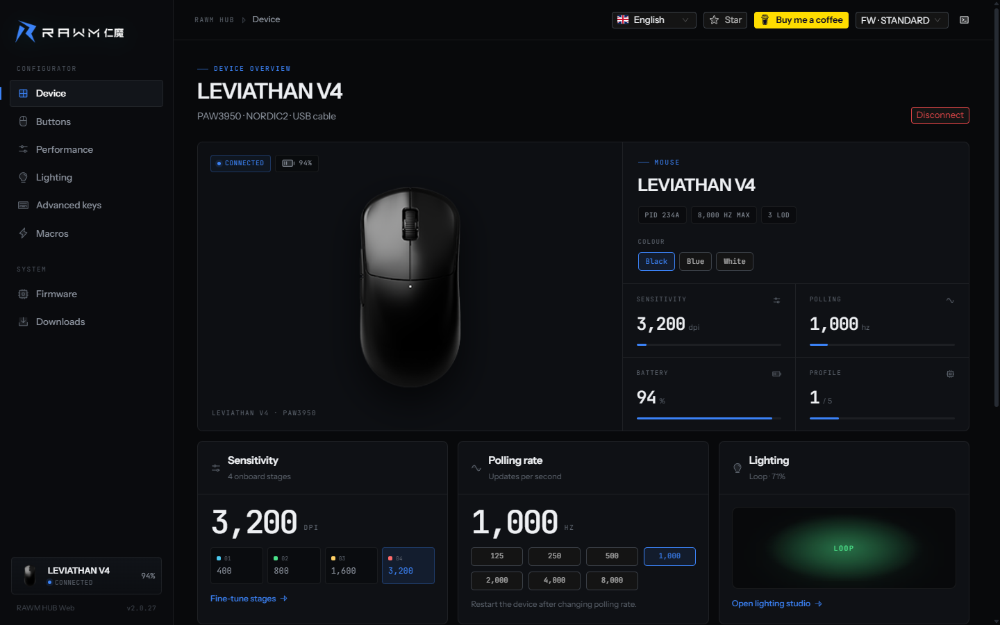
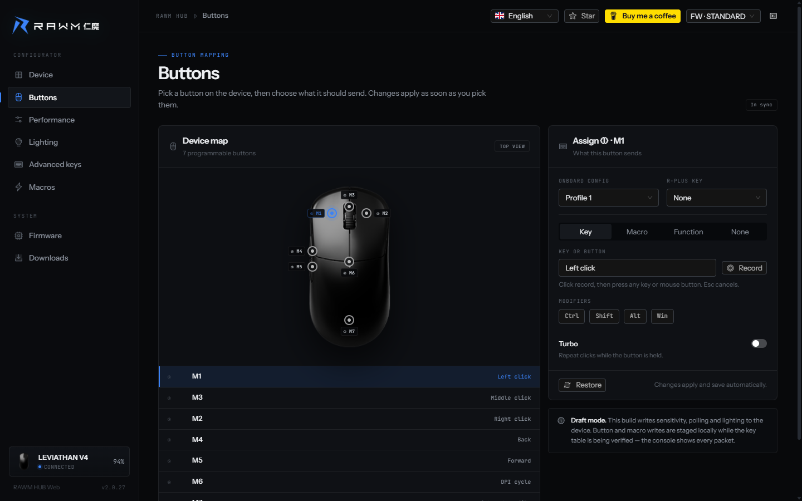

# RAWM HUB — rebuilt

A browser-native configurator for RAWM mice and keyboards, rebuilt from
[rawmtech.com/hub.html](https://www.rawmtech.com/hub.html). It keeps the device
features of the original hub, uses the layout language of
[control.openmouse.app](https://control.openmouse.app) and
[hub.atk.pro](https://hub.atk.pro), and talks to real hardware over WebHID
(vendor `0x1915`). There is no demo mode.

The deliverable is a **single self-contained `index.html`** with React, Ant
Design, fonts, icons and product renders inlined. No runtime CDN, no build step
needed to open the built file.

- Live app: <https://better-rawmhub.chila.io.vn> (also on <https://better-rawmhub.pages.dev>)
- Source and issues: <https://github.com/thinhphoenix/better-rawmhub>





## Run it

```bash
npm install        # first time only
npm start          # builds nothing, starts the server and opens Chrome
npm run serve      # server only, no browser launch
```

Open <http://localhost:8080>. Use **Chrome or Edge** on desktop; WebHID is not
available in Safari or Firefox.

`npm start -- --no-open` keeps the server running without opening a window, and
falls back to the default browser when Chrome is not installed.

## What is here

| Area | Description |
| --- | --- |
| Device | Product render, live DPI / polling / battery / profile summary, onboard slots with Switchable and colour dots |
| Buttons | Product map with clickable hotspots, key list, key / macro / function assignment, onboard config, R-Plus key, key capture, turbo |
| Performance | DPI stages with X/Y and per-stage colours, polling rates with X-Polling, glass mode, LOD, angle tuning/snapping, ripple control, motion sync, performance mode, wireless turbo, sleep and key delay |
| Lighting | Loop / Customize / DPI-level modes, colour palette, brightness/speed, glass mode, per-zone switches, per-key painting for keyboards |
| Advanced keys | SOCD, tap-hold (MT), rapid-trigger priority (RS) and dynamic keystroke (DKS) editors |
| Macros | Macro library, action timeline, delay editing and capture |
| Firmware | Revision, channel report, vendor hand-off and factory reset. Changing the channel writes it, reboots the device and disconnects, so you connect again manually |
| About | What the project is, requirements, credits and links to the official RAWM HUB installers, web tool and download center. The page hosts no downloads |
| Console | Live WebHID packet log (TX/RX), copyable for debugging |
| Language | English, Vietnamese, Chinese, Japanese, Thai, Korean and Spanish; flag picker in the header, choice saved locally |

Scope is intentionally limited to this list — no extra pages or controls beyond
the original hub.

## Settings apply automatically

There is no **Write to device** button:

- Every settings change is written to the mouse right away, coalesced by a
  ~260 ms debounce so slider drags and repeated clicks send one packet.
- After you stop interacting for ~1.2 s the app sends **save to onboard memory**,
  so the change survives a reboot.
- The page header shows **Unsaved changes → In sync** while this happens.
- Live device notifications (battery, CPI, polling, profile) update the visible
  values in place. Changes never rebuild the page, so images, Ant Design
  controls and scroll position stay put — no flicker.

Written over WebHID: mouse parameters (`CONFIG_TYPE_MOUSE_PARAM`), lighting,
brightness, sleep time, save-to-flash and factory restore.

**Not written to hardware yet:** button remaps, macros and HS keyboard
configuration. Their UIs are complete and staged locally; the key tables differ
per model and were not verified against a physical keyboard. The console log is
there to finish that work with a device in hand.

## Real device support

The transport was reconstructed from the vendor bundle (`library.min.js`, build
2026-06-01) and the public device catalogue. It implements:

- WebHID discovery for vendor `0x1915`, handshake and re-query
- Two-stage receiver handshake: query the dongle directly, then query the paired
  device on channel 0 and adopt its product id, name and render
- The `CMD` protocol: `QUERY` / `QUERY_RESULT` / `CONFIG` / `ACTION` / `NOTIFY`
  framing
- Receiver routing (extended packet, channel 0) and direct USB framing
- CRC-16/CCITT-FALSE wrapping (`CONFIG_TYPE_CRC`) when the device reports `crc: 1`
- Query-result JSON parsing (revision, battery, CPI, polling, LOD, angle, ripple,
  profiles), plus live notifications
- Output-report length auto-detection (32/64 bytes) with fallback, and TX
  fragmentation for long config packets
- HS keyboard firmware handshake (`IQ_GET_SOFT_DRV_VER`) with raw logging

The packet layout notes live at the top of `src/hid.js`.

## Project layout

```
index.html               generated single-file build (open this)
public/index.html        same build, ready for Cloudflare Pages
src/template.html        shell, header, favicon reference
src/styles.css           design system (blue, flat, dark)
src/ant-controls.js      real antd Button / Switch / Select / Slider / Segmented
src/hid.js               WebHID transport, framing, CRC, config packets
src/app.js               views, state, auto-apply, interactions, router
src/catalogue.json       device catalogue (36 entries, vendor data)
assets/ant.js            React + antd bundle (inlined by the build)
assets/products/         one local render, used as the loading placeholder
assets/rawm-hub.png      official logo, bolt recoloured to theme blue
assets/favicon.ico       favicon (inlined by the build)
src/i18n.js             translation engine (text/attribute walker, language switch)
src/ascii-bg.js         drift field: ASCII background canvas (24 fps, pauses when hidden)
src/locales/*.json      English, Vietnamese, Chinese, Japanese, Thai, Korean, Spanish
assets/flags/           flag renders for the language picker (inlined by the build)
tools/build.mjs          inlines CSS, JS, JSON, images, icons and favicon
tools/start.mjs          local server + Chrome launcher
tools/release.mjs        bump patch, build, deploy, commit, push
tools/test-transport.mjs framing, CRC and receiver-routing tests
tools/recolor-logo.mjs   recolours the logo bolt to #3b82f6
tools/fetch-products.mjs downloads per-model renders into assets/products/
reference/               vendor bundle and catalogue used for research (ignored)
wrangler.toml            Cloudflare Pages project config
shots/                   README screenshots
```

Rebuild after editing anything in `src/`:

```bash
npm run build                    # bundles antd, then inlines everything
node tools/test-transport.mjs    # 7 framing / CRC / routing checks
```

Product renders load from the vendor hub at
`https://hub.miracletek.net/hub/product/<product_id>/<model>/connected.png`.
`assets/products/234a-black.png` (LEVIATHAN V4, black) ships inside the bundle
and is shown while a render downloads, or when a device has no render at all.
Files placed in `assets/products/` are still inlined by the build and win over
the remote URL; the placeholder file itself is reserved and skipped.

Colour variants come from each device's `models` list. The Device tab shows a
colour picker whenever there is more than one, and the choice is remembered in
`localStorage`.

`index.html` and `public/index.html` are generated — edit `src/`, not the build.

## Versioning

`package.json` is the single source of truth. The build injects the version into
the rail footer and `<meta name="app-version">`.

```bash
npm run bump      # 2.0.19 -> 2.0.20, no build or deploy
npm run ship      # bump + build + commit + push (Cloudflare Pages deploys)
npm run release   # bump + build + wrangler deploy + commit + push
```

## Deploy (Cloudflare Pages)

The build writes a deployable folder to `public/` (a single `index.html`).

```bash
npm run cf:login   # once, opens the browser
npm run deploy     # build + upload to the Pages project
```

- Live URL: <https://better-rawmhub.chila.io.vn>
- Fallback URL: <https://better-rawmhub.pages.dev>
- Pages project: `better-rawmhub`, production branch `main`.
- Build command for CI/Cloudflare: `npm run build`, output directory: `public`.
  Do **not** use `npm run release` there — it commits and deploys recursively.
- `public/` is git-ignored; it is rebuilt from `src/` on every deploy.
- For CI, set `CLOUDFLARE_API_TOKEN` and `CLOUDFLARE_ACCOUNT_ID`, then run
  `npm run deploy`.

WebHID works on the `*.pages.dev` HTTPS URL; no extra headers or service worker
are needed.

## Google indexing

The build writes `robots.txt`, `sitemap.xml` and `og-image.png` next to
`index.html`, and the page itself carries a canonical URL, description,
Open Graph/Twitter tags and SoftwareApplication JSON-LD.

1. Open [Google Search Console](https://search.google.com/search-console) and add
   the custom domain as a **URL prefix** property:
   `https://better-rawmhub.chila.io.vn/`.
2. Verify with the **HTML tag** method. Copy the token from the `content="…"`
   attribute and build with it:

   ```bash
   # PowerShell
   $env:GOOGLE_SITE_VERIFICATION="your-token"; npm run deploy
   # bash
   GOOGLE_SITE_VERIFICATION=your-token npm run deploy
   ```

   Set the same variable in the Cloudflare Pages project so every automatic
   build keeps the tag.

   HTML-file alternative: download the `google…html` file from Search Console,
   put it in the repository root, and run `npm run deploy`. The build copies any
   `google*.html` file into `public/` so it is served at the site root.

   DNS alternative: add a **TXT** record for the exact host Google asks for
   (`better-rawmhub` in `chila.io.vn`, not just the apex). A Domain property for
   `chila.io.vn` also covers every subdomain.
3. Submit `https://better-rawmhub.chila.io.vn/sitemap.xml` under **Sitemaps**.
4. Use **URL Inspection** → **Request indexing** for the home page.
5. Add the live URL to the GitHub repository description and README, and link it
   from forum posts or reviews. Backlinks matter more than tags for short
   queries.

Indexing takes days to weeks. Brand queries such as *RAWM HUB Web*,
*Better RAWM HUB* or *RAWM web configurator* are realistic targets; the bare
word *RAWM* is owned by the vendor and cannot be guaranteed.

The name Google prints above each result (the site name) is taken from the
`WebSite` structured data on the home page, then from `og:site_name`, the
`<title>`, headings and other home-page text. Every one of those signals uses
the same string, **Better RAWM Hub**, with the domain listed last in
`alternateName` as the documented fallback. Change it in `src/template.html`
and `src/app.js` together, or Google will fall back to `chila.io.vn`.

## Design

- Dark cockpit shell: 250px rail, sticky topbar, 1240px content column.
- Blue accent `#3b82f6`; flat near-black surfaces and 1px hairlines.
- 8px card radius, 4px controls; no gradients, glows, grid overlays or spinning
  hero effects.
- Instrument Sans for UI, JetBrains Mono for numbers and micro-labels.
- Controls are real Ant Design 5 components (Button, Switch, Select, Slider,
  Segmented) mounted over the custom layout; React and antd are bundled into
  `index.html`.
- Phosphor **duotone** icons are emitted as a `<symbol>` sprite.
- Behind the shell: a slow ASCII field (the *drift* look from
  [asciify-engine](https://github.com/ayangabryl/asciify-engine), MIT). Glyphs
  sit on a 13 px grid over a two-octave value-noise field, sampled on a coarse
  grid and interpolated, drawn with a short trail at 24 fps. Opaque cards and
  the rail hide it where text lives; it stops when the tab is hidden and renders
  one static frame under `prefers-reduced-motion`.
- UI text is translated into English, Vietnamese, Chinese, Japanese, Thai,
  Korean and Spanish. The language picker shows inlined flag renders and the
  choice is stored in `localStorage`.
- Official RAWM HUB logo in the rail, bolt recoloured to the theme blue; product
  renders load from the vendor's `/hub/product/{productId}/{model}/` endpoint.
- `assets/products/234a-black.png` is inlined as the placeholder shown while a
  render downloads or when a device has no render of its own.
- Matched devices show a colour picker when they expose more than one model;
  the choice is remembered in `localStorage`.
- Responsive down to 390px: the rail collapses to an icon strip.

## Notes

- Product images, names and the device catalogue belong to RAWM / Shenzhen
  Renmo Electronic Technology. This is an unofficial interface rebuild.
- Firmware flashing is intentionally not attempted in the browser; the firmware
  page hands off to the official desktop updater.
- `reference/` is research material only and is not required at runtime.
