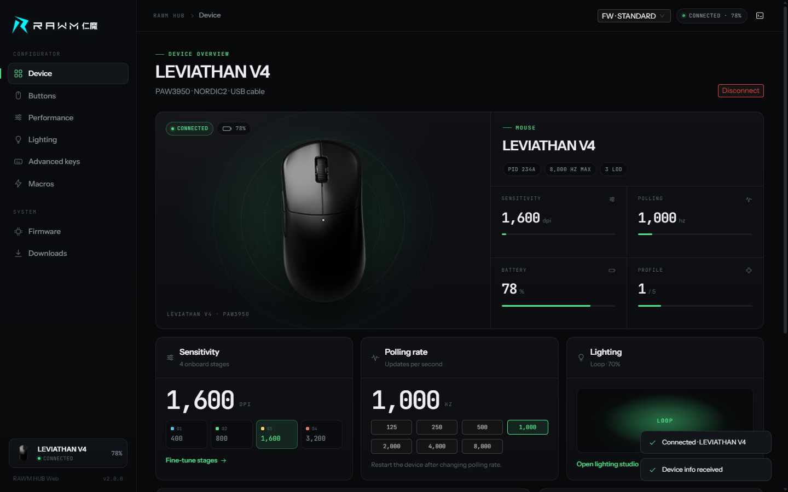

# RAWM HUB — rebuilt

A cleaner, browser-native configurator for RAWM mice and keyboards, rebuilt from
[rawmtech.com/hub.html](https://www.rawmtech.com/hub.html) with the layout language of
[control.openmouse.app](https://control.openmouse.app) and [hub.atk.pro](https://hub.atk.pro).

The deliverable is a **single self-contained `index.html`** with React and Ant Design
bundled in, no runtime CDN and no build step needed to run the built file. It talks to real
hardware over WebHID (vendor `0x1915`) — there is no demo mode.



## Run it

```bash
# first time only, to rebuild from src/
npm install
npm run build

# starts the local server and opens Chrome at http://localhost:8080
npm start

# server only (no browser launch)
npm run serve
```

`npm start -- --no-open` keeps the server running without opening a window. If Chrome is
not found, it falls back to the default browser.

Open <http://localhost:8080>. Use **Chrome or Edge** on desktop; WebHID is not exposed in
Safari or Firefox.

## What is here

| Area | Description |
| --- | --- |
| Device | Product render, live DPI / polling / battery / profile summary, onboard slots with Switchable and colour dots |
| Buttons | SVG device map with clickable zones, key / macro / function assignment, onboard config, R-Plus key, key capture, turbo |
| Performance | DPI stages with X/Y and per-stage colours, polling rates with X-Polling, glass mode, LOD, angle tuning/snapping, ripple control, motion sync, performance mode, wireless turbo, sleep and key delay |
| Lighting | Loop / Customize / DPI-level modes, colour palette, brightness/speed, glass mode, per-zone switches, per-key painting for keyboards |
| Advanced keys | SOCD, tap-hold (MT), rapid-trigger priority (RS) and dynamic keystroke (DKS) editors |
| Macros | Macro library, action timeline, delay editing and capture |
| Firmware | Revision and channel report, vendor updater hand-off, factory reset |
| Downloads | Official desktop / Android / iOS builds and local-run instructions |
| Console | Live WebHID packet log (TX/RX), copyable for debugging |

Scope is intentionally limited to this list — no extra pages or controls beyond it.

Connection is hardware-only: Chrome/Edge prompts for a RAWM device on vendor `0x1915`.

## Real device support

The transport was reconstructed from the vendor bundle (`library.min.js`, build 2026-06-01)
and the public device catalogue. It implements:

- WebHID discovery for vendor `0x1915`, handshake and re-query
- Two-stage receiver handshake: query the dongle directly, then query the paired device on channel 0 and adopt its product id, name and render
- The `CMD` protocol: `QUERY` / `QUERY_RESULT` / `CONFIG` / `ACTION` / `NOTIFY` framing
- Receiver routing (extended packet, channel 0) and direct USB framing
- CRC-16/CCITT-FALSE wrapping (`CONFIG_TYPE_CRC`) when the device reports `crc: 1`
- Query-result JSON parsing (revision, battery, CPI, polling, LOD, angle, ripple, profiles)
- Live notifications (battery, CPI, polling, onboard index, RSSI)
- Writes: mouse parameters (`CONFIG_TYPE_MOUSE_PARAM`), lighting, brightness, sleep time,
  save-to-flash and factory restore
- HS keyboard firmware handshake (`IQ_GET_SOFT_DRV_VER`) with raw logging

**Not written to hardware yet:** button remaps, macros and HS keyboard configuration. Their
UIs are complete and staged locally; the key tables differ per model and were not verified
against a physical keyboard. The console log is there to finish that work with a device in
hand.

The packet layout notes live at the top of `src/hid.js`.

## Project layout

```
index.html            generated single-file build (open this)
src/template.html     shell + SVG sprite
src/styles.css        design system (dark)
src/ant-controls.js   mounts real antd Button / Switch / Select / Slider / Segmented
src/hid.js            WebHID transport, framing, CRC, config packets
src/app.js            views, state, interactions, router
assets/ant.js         React + antd bundle (inlined by the build)
assets/products/      downloaded per-model renders (inlined by the build)
assets/rawm-hub.png   official logo (inlined by the build)
tools/ant-entry.js    antd bundle entry point
src/catalogue.json    device catalogue (36 entries, vendor data)
tools/build.mjs       inlines CSS/JS/JSON into index.html
tools/fetch-products.mjs downloads per-model renders into assets/products/
tools/test-transport.mjs  framing, CRC and receiver-routing tests
reference/            vendor bundle, catalogue and product renders used for research
shots/                UI screenshots
```

Rebuild after editing `src/`:

```bash
npm run build                    # bundles antd, then inlines everything
node tools/test-transport.mjs    # framing, CRC and receiver-routing checks
```

## Design

- Dark cockpit shell: 250px rail, sticky topbar, 1240px content column.
- Official RAWM HUB logo in the rail; product renders come from the vendor's
  `/hub/product/{productId}/{model}/connected.png` endpoint. The build downloads one
  render per mouse and inlines it (along with the logo and catalogue icons), so
  `index.html` never depends on the CDN or the `assets/` folder for images.
- Devices without a downloaded render (receivers or a few models) use the inline SVG
  placeholder; `src/` no longer references `assets/devices` at all.
- Mint accent `#4be38a`, layered near-black surfaces, 1px hairlines.
- Instrument Sans for UI, JetBrains Mono for numbers and micro-labels.
- Controls are real Ant Design 5 components (Button, Switch, Select, Slider, Segmented)
  mounted over the custom layout; React and antd are bundled into `index.html`.
- Responsive down to 390px: the rail collapses to an icon strip.

## Notes

- Product images, names and the device catalogue belong to RAWM / Shenzhen Renmo Electronic
  Technology and are loaded from their CDN. This is an unofficial interface rebuild.
- Firmware flashing is intentionally not attempted in the browser; the firmware page hands
  off to the official desktop updater.
- `reference/` is research material only and is not required at runtime.
