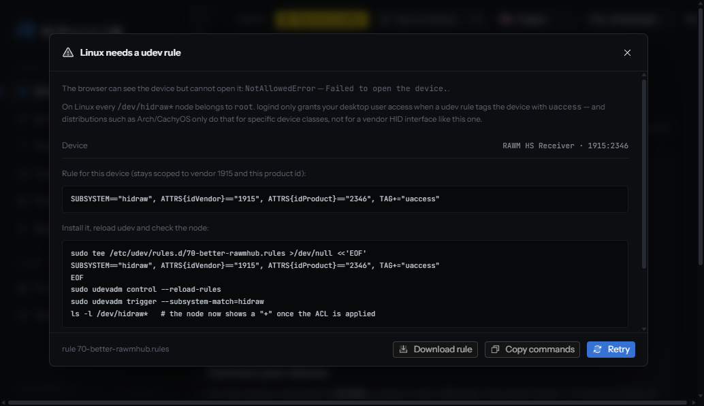

# Linux permissions

Chrome and Edge can list a RAWM device but every `open()` fails with:

```
NotAllowedError: Failed to open the device.
```

That is not a browser bug and not a WebHID limitation. On Linux the device is
exposed as `/dev/hidrawN`, the node is owned by `root`, and the browser runs as
your user. logind only grants your desktop session access to the node when a
udev rule tags it with `uaccess`.

Most distributions ship rules for keyboards, mice and joysticks. Arch-based
systems such as CachyOS ship a narrow `/usr/lib/udev/rules.d/70-uaccess.rules`
that does not cover a vendor-defined HID interface, so a RAWM receiver stays
`crw------- root root` with no ACL for you.

Check what the OS thinks:

```sh
ls -l /dev/hidraw*
# crw------- 1 root root 241, 1 ... /dev/hidraw1   ← no "+", no ACL
```

## Fix

Pick the product id of your device — the app prints `VID 0x1915 PID 0x2346`
when the open fails, and `lsusb | grep 1915` shows it too.

Create `/etc/udev/rules.d/70-better-rawmhub.rules`:

```sh
sudo tee /etc/udev/rules.d/70-better-rawmhub.rules >/dev/null <<'EOF'
SUBSYSTEM=="hidraw", ATTRS{idVendor}=="1915", ATTRS{idProduct}=="2346", TAG+="uaccess"
EOF
```

Drop `, ATTRS{idProduct}=="2346"` to cover every RAWM device instead of one
product. Then reload the rules and re-apply them to the existing nodes:

```sh
sudo udevadm control --reload-rules
sudo udevadm trigger --subsystem-match=hidraw
ls -l /dev/hidraw*
# crw-rw----+ 1 root root ... /dev/hidraw1   ← the "+" is your ACL
```

Unplug and replug the receiver if the browser still refuses, then press
**Retry** in the app (or reload the page and press **Connect device**).

The web app shows this rule for the selected device, with **Copy commands** and
**Download rule** buttons, whenever an open fails with `NotAllowedError` on
Linux.



## Why the file name matters

`70-` is deliberate. The ACL is applied by `73-seat-late.rules`, so any rule
that grants `uaccess` has to be read before it. A name such as
`99-better-rawmhub.rules` can silently do nothing.

## Keep it scoped

The rule above only tags vendor `1915` — and only the product id when you keep
that clause. It grants your *logged-in user* an ACL on those nodes; it does not
open hidraw to every account on the machine.

Never solve this by:

- running Chrome or Edge as root or with `--no-sandbox`;
- `chmod 666 /dev/hidraw*` (world-writable device nodes, and it resets on replug);
- a blanket `SUBSYSTEM=="hidraw", TAG+="uaccess"` rule that hands every HID
  device — including keyboards and security keys — to any logged-in user.

## Still failing?

| Check | What to do |
| --- | --- |
| `ls -l` has no `+` | the rule did not apply: confirm the file name, rerun `udevadm control --reload-rules` and `udevadm trigger --subsystem-match=hidraw` |
| `+` is there but open still fails | another process holds the interface (vendor hub, another tab, a VM); close it and retry |
| Wrong node | the receiver exposes several hidraw nodes; the browser asks for the vendor interface, but the rule must match `1915` on all of them |
| Chrome installed as Flatpak/Snap | grant the browser access to the hidraw device through the sandbox, e.g. `flatpak override --user --device=all com.google.Chrome`, or use the distribution package |
| USB device itself is missing | `lsusb \| grep 1915` — try another port or cable before blaming permissions |

## Read-only `/etc`

On SteamOS, NixOS and other immutable systems you cannot write to
`/etc/udev/rules.d` directly:

- **SteamOS**: `sudo steamos-readonly disable`, add the rule, then
  `sudo steamos-readonly enable`. Updates may reset it.
- **NixOS**: add the rule declaratively, for example
  `services.udev.extraRules = ''SUBSYSTEM=="hidraw", ATTRS{idVendor}=="1915", TAG+="uaccess"'';`
  and rebuild.

## Alternative: the local bridge

The [bridge](../bridge/README.md) runs as your user and needs the same
`uaccess` ACL for hidraw, so it is not a way around this rule. It does help when
the browser has no WebHID at all (Firefox, Safari, or Chrome builds with the API
disabled) — `bridge/install.sh` installs the vendor-wide rule and the daemon.
